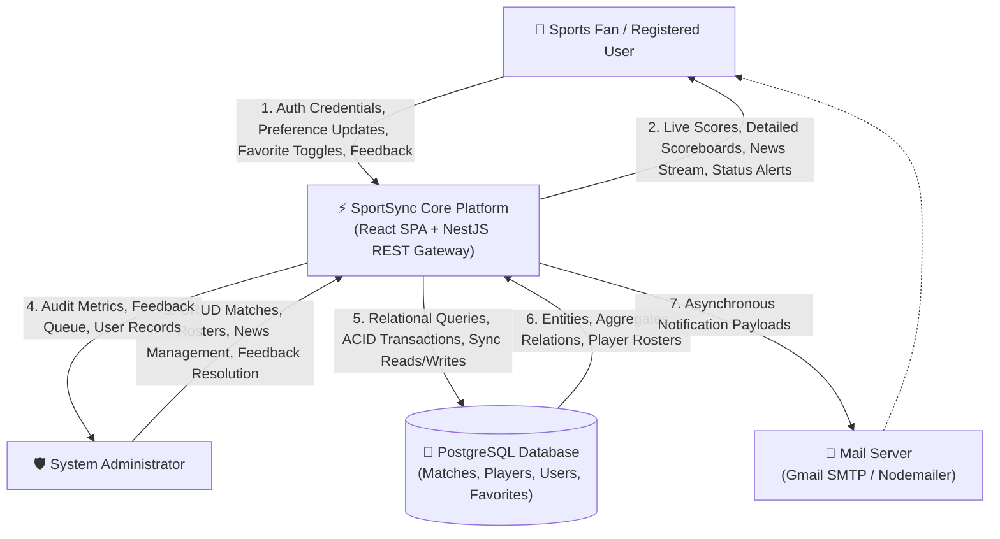
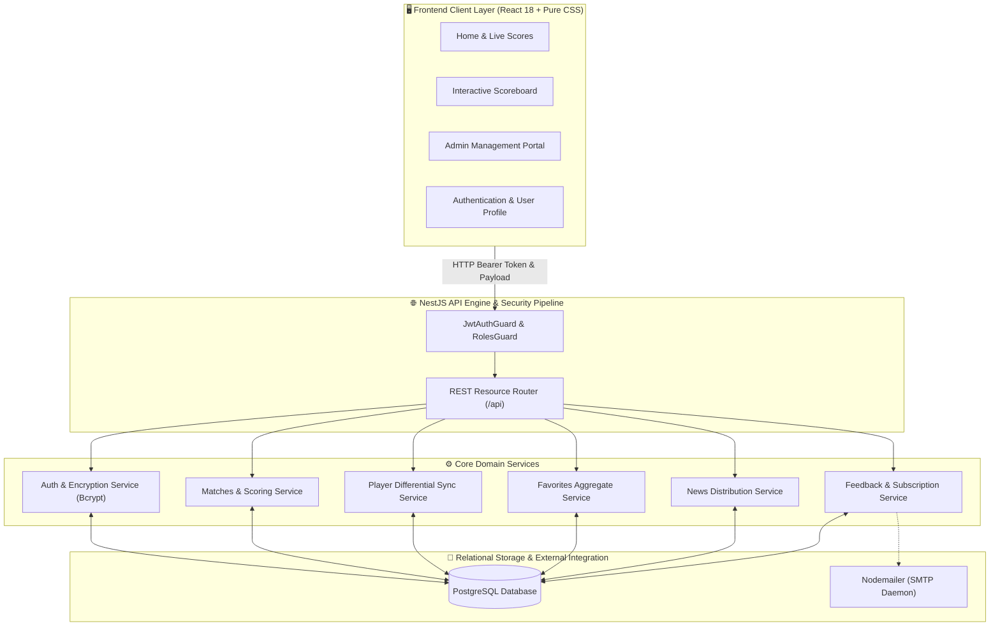
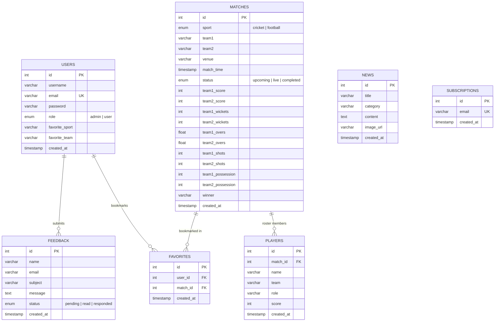

<div align="center">

# ⚡ SportSync

### **Next-Gen Real-Time Sports Intelligence & Full-Stack Match Tracking Ecosystem**

[](https://reactjs.org/)
[](https://vitejs.dev/)
[](https://www.w3.org/Style/CSS/)
[](https://nestjs.com/)
[](https://www.postgresql.org/)
[](https://typeorm.io/)
[](https://jwt.io/)
[](LICENSE)

<br/>

**A unified, high-performance sports telemetry and live scoreboard platform.**  
Featuring automated score differential calculations, real-time polling synchronization, pure vanilla CSS3 design system (zero CSS frameworks), relational persistence with PostgreSQL & TypeORM, role-based access control (RBAC), and interactive cricket and football match analytics.

[🌐 Web Client](http://localhost:3000) • [📡 Backend API](http://localhost:5000/api) • [📖 Documentation](#-table-of-contents) • [⚡ Quickstart](#-quickstart--local-setup)

</div>

---

## 📑 Table of Contents
- [🌟 Key Highlights](#-key-highlights)
- [🗺️ System Architecture & Data Flow Diagrams (DFD)](#️-system-architecture--data-flow-diagrams-dfd)
  - [Level 0 DFD: Context Diagram](#level-0-dfd-context-diagram)
  - [Level 1 DFD: Subsystem Decomposition](#level-1-dfd-subsystem-decomposition)
- [🧩 Database Entity-Relationship Architecture](#-database-entity-relationship-architecture)
- [⚡ Engineering Deep-Dive](#-engineering-deep-dive)
- [💻 Tech Stack Matrix](#-tech-stack-matrix)
- [🚀 Quickstart & Local Setup](#-quickstart--local-setup)
- [🔐 Secure Environment Configuration](#-secure-environment-configuration)
- [🛡️ Role-Based Access Control (RBAC) & Accounts](#️-role-based-access-control-rbac--accounts)
- [📡 Comprehensive API Endpoints Specification](#-comprehensive-api-endpoints-specification)
- [🎨 Pure Vanilla CSS3 Design Principles](#-pure-vanilla-css3-design-principles)
- [📦 Production Deployment & Build](#-production-deployment--build)

---

## 🌟 Key Highlights

<table>
<tr>
<td width="50%" valign="top">

### ⚡ Live Sports Telemetry & Analytics
- **Multi-Sport Engine**: Tailored scoring systems for both **Cricket** (runs, wickets, overs, batting/bowling economy) and **Football** (goals, shots on target, possession breakdown, lineup rosters).
- **Auto-Sync Differential Engine**: Adding, updating, or deleting player statistics triggers differential recalculations of match scores without database race conditions.
- **Automated Winner Determination**: Setting match status to `completed` executes deterministic winner evaluation (`team1`, `team2`, or `Draw`).
- **Real-Time Polling & Live Pulse**: Background polling every 15 seconds with animated CSS keyframe pulse indicators for live matches.

</td>
<td width="50%" valign="top">

### 🛡️ Enterprise NestJS & Relational Architecture
- **Pure Vanilla CSS Architecture**: 100% bespoke responsive styling using CSS variables, flexbox, grid, and transitions—completely free from Tailwind, Bootstrap, or component libraries.
- **Relational PostgreSQL Engine**: Strongly typed schema with TypeORM entities, cascading deletes, foreign key integrity, and unique composite indexes.
- **Dual Password Hashing Support**: Seamless legacy MD5 migration to modern `bcrypt` password hashing upon user login.
- **Modular Micro-Architecture**: Decoupled NestJS controllers, services, DTO validation pipes, custom execution context decorators, and guards.

</td>
</tr>
</table>

---

## 🗺️ System Architecture & Data Flow Diagrams (DFD)

### Level 0 DFD: Context Diagram
The boundary between external actors, SportSync ecosystem, and notification/SMTP services:



---

### Level 1 DFD: Subsystem Decomposition
Detailed transaction and data flow within the application micro-modules:



---

## 🧩 Database Entity-Relationship Architecture

The PostgreSQL schema is modeled via TypeORM entities with foreign key constraints, cascading lifecycle rules, and relational integrity:



---

## ⚡ Engineering Deep-Dive

### 1. Score Auto-Sync via Differential Calculus
Instead of executing full table counts across all historical player entries, `PlayersService` utilizes atomic differentials:
$$\Delta \text{Score} = \text{Score}_{\text{new}} - \text{Score}_{\text{old}}$$
When an admin updates a player's runs or goals, the match's aggregate team score automatically updates:
$$\text{TeamScore}_{t+1} = \text{TeamScore}_t + \Delta \text{Score}$$
Deleting a player automatically deducts their score contribution, guaranteeing instant consistency across cards, lists, and detailed scoreboards.

### 2. Transparent Legacy MD5 to Bcrypt Upgrade
To allow smooth migration without requiring mass user password resets:
1. When a user submits credentials, the server verifies `bcrypt.compare()`.
2. If bcrypt verification fails, the server calculates `md5(inputPassword)`.
3. If MD5 matches the stored legacy hash, the password is auto-rehashed with `bcrypt` (salt rounds = 10), updated in PostgreSQL, and authenticated transparently.

### 3. Asynchronous Safe Email Notification
Submitting user feedback or newsletter subscriptions does not block HTTP execution. Mail dispatch operations execute within decoupled asynchronous promises with failure containment: if external SMTP drops or rate limits, database records remain committed while notifying logs cleanly.

---

## 💻 Tech Stack Matrix

| Area | Component | Implementation Details |
|------|-----------|------------------------|
| **Frontend Framework** | React 18.3.1 (Vite) | Single-Page Application (SPA) architecture with React Router v6 |
| **Styling & Design** | Pure Vanilla CSS3 | Custom Properties (variables), CSS Grid, Flexbox, Keyframe Animations |
| **Icons & UX** | Lucide React | Lightweight tree-shaken SVG icon system |
| **HTTP Transport** | Axios Client | Global instance with dynamic JWT injection interceptors & error interceptors |
| **Backend Framework**| NestJS 10.x | Enterprise TypeScript micro-framework with DI container |
| **Database & ORM** | PostgreSQL 16+ & TypeORM | Strict types, native enums, eager/lazy relations, schema synchronization |
| **Security & Auth** | Passport-JWT & Bcrypt | JWT Strategy, stateless bearer authorization, custom `@Roles()` decorator |
| **Email Protocol** | Nodemailer | SMTP transport configuration for transactional auto-responders |

---

## 🚀 Quickstart & Local Setup

### Prerequisites
- **Node.js** >= 18.0.0
- **npm** >= 9.0.0
- **PostgreSQL** >= 14 running on port `5432`

---

### Step 1: Database Initialization
Ensure PostgreSQL is active and create the database instance:
```bash
psql -U postgres -c "CREATE DATABASE sport_sync;"
```

---

### Step 2: Backend Setup (NestJS)
Navigate to the backend directory, install packages, initialize the environment file, and run database seeding:

```bash
cd backend-nest
npm install

# Initialize your environment variables
cp .env.example .env

# Run database seeder (populates users, matches, players, news)
npm run seed

# Launch NestJS development server
npm run start
```
> 🚀 API Gateway running at: `http://localhost:5000/api`

---

### Step 3: Frontend Setup (React + Vite)
In a new terminal window, navigate to the frontend directory, install dependencies, and start the Vite development server:

```bash
cd frontend
npm install

# Launch frontend application
npm run dev
```
> 🌐 Web Client accessible at: `http://localhost:3000`

---

## 🔐 Secure Environment Configuration

All production keys and passwords are kept out of source control. Copy `.env.example` into `backend-nest/.env` and provide your parameters:

```env
# Application Port & Mode
PORT=5000
NODE_ENV=development

# PostgreSQL Connection
DB_HOST=localhost
DB_PORT=5432
DB_USERNAME=postgres
DB_PASSWORD=your_secure_password
DB_DATABASE=sport_sync

# Security & JSON Web Tokens
JWT_SECRET=your_super_secret_jwt_signing_key_at_least_32_chars
JWT_EXPIRES_IN=7d

# SMTP Configuration (Optional for notifications)
SMTP_HOST=smtp.gmail.com
SMTP_PORT=587
SMTP_USER=your_email@gmail.com
SMTP_PASS=your_app_specific_password
SMTP_FROM="SportSync <noreply@sportsync.com>"

# CORS White-listing
CORS_ORIGIN=http://localhost:3000
```

> [!NOTE]
> `.env` files are explicitly added to `.gitignore`. Never commit actual API keys or credentials to public Git repositories.

---

## 🛡️ Role-Based Access Control (RBAC) & Accounts

The database seeder provisions predefined test accounts:

| Role | Email Address | Password | Permissions & Scope |
|------|---------------|----------|---------------------|
| **Admin** | `admin@sportsync.com` | `admin123` | Full access: match creation, news publishing, feedback manager, in-place scoreboard score editor |
| **Admin** | `varunjoshi@gmail.com` | `admin123` | Full administrator rights |
| **User** | `test@example.com` | `password123` | Bookmark matches, custom favorite team/sport preferences, feedback submissions |

---

## 📡 Comprehensive API Endpoints Specification

### 🔐 Auth & Identity
| Method | Endpoint | Protection | Description |
|---|---|---|---|
| `POST` | `/api/auth/register` | Public | Register new user account |
| `POST` | `/api/auth/login` | Public | Verify credentials & issue JWT Bearer Token |
| `GET` | `/api/auth/me` | User / Admin | Retrieve current authenticated session identity |

### 🏆 Matches & Live Scores
| Method | Endpoint | Protection | Description |
|---|---|---|---|
| `GET` | `/api/matches` | Public | List matches (query params: `sport`, `status`, `search`) |
| `GET` | `/api/matches/live` | Public | Stream live matches across sports |
| `GET` | `/api/matches/:id` | Public | Detailed match scoreboard with complete team rosters |
| `POST` | `/api/matches` | Admin | Create a new match event |
| `PUT` | `/api/matches/:id` | Admin | Update match score/status (auto-evaluates winner) |
| `DELETE` | `/api/matches/:id` | Admin | Cascade delete match record |

### 🏃 Roster & Player Telemetry
| Method | Endpoint | Protection | Description |
|---|---|---|---|
| `GET` | `/api/players?match_id=:id`| Public | Fetch active player lineup for match |
| `POST` | `/api/players` | Admin | Add player to team roster (auto-increments match score) |
| `PUT` | `/api/players/:id/score` | Admin | Update player score (differential sync to match) |
| `DELETE` | `/api/players/:id` | Admin | Remove player (deducts score from team total) |

### ❤️ Personalization & User Space
| Method | Endpoint | Protection | Description |
|---|---|---|---|
| `POST` | `/api/favorites/toggle` | User / Admin | Toggle match bookmark (AJAX) |
| `GET` | `/api/favorites` | User / Admin | List user's bookmarked matches with dual filtering |
| `PUT` | `/api/users/preferences` | User / Admin | Update profile favorite team and sport |
| `POST` | `/api/users/change-password`| User / Admin | Verify existing password and change |
| `DELETE` | `/api/users/account` | User / Admin | 2-step account purge with password confirmation |

### 📰 News, Feedback & Subscriptions
| Method | Endpoint | Protection | Description |
|---|---|---|---|
| `GET` | `/api/news` | Public | Fetch latest sports news (with sport filter) |
| `GET` | `/api/news/all` | Admin | List all news for administrative moderation |
| `POST` | `/api/news` | Admin | Publish sports news article |
| `PUT/DELETE`| `/api/news/:id` | Admin | Edit or remove published news article |
| `POST` | `/api/feedback` | Public | Submit user feedback |
| `GET` | `/api/feedback` | Admin | Review user feedback submissions |
| `PUT` | `/api/feedback/:id/status` | Admin | Transition status (`pending`, `read`, `responded`) |
| `POST` | `/api/subscriptions` | Public | Newsletter subscription intake |

---

## 🎨 Pure Vanilla CSS3 Design Principles

SportSync strictly avoids UI component libraries and CSS utility generators:
- **Design Tokens**: Standardized CSS variables defined in `:root` (`--bg-primary`, `--accent-red`, `--radius-md`, `--border-color`).
- **Responsive Layouts**: Native CSS Grid and Flexbox for clean layout shifts across mobile, tablet, and ultra-wide displays.
- **Micro-Interactions**: Custom `@keyframes livePulse` for live indicators, rotational transforms for reloaders, and smooth dropdown transitions.

---

## 📦 Production Deployment & Build

### 1. Build Frontend
```bash
cd frontend
npm run build
```
Generates an optimized, tree-shaken static production bundle in `frontend/dist/`.

### 2. Build & Launch Backend
```bash
cd backend-nest
npm run build
npm run start:prod
```

---

<div align="center">

Made with ❤️ for Sports Lovers • **SportSync Ecosystem**

</div>
